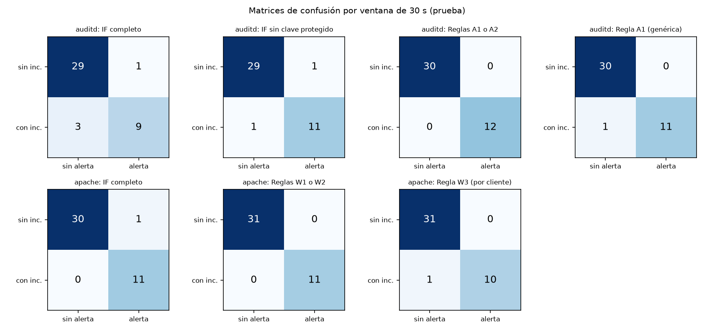
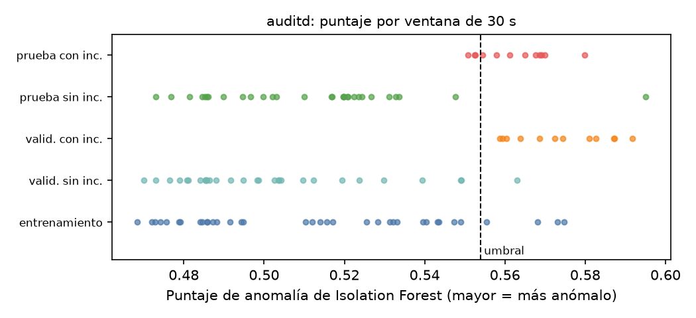
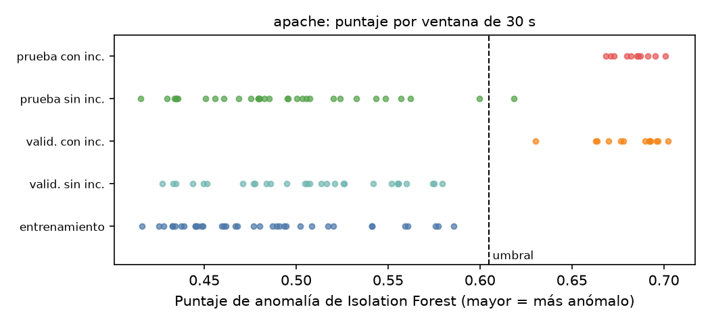
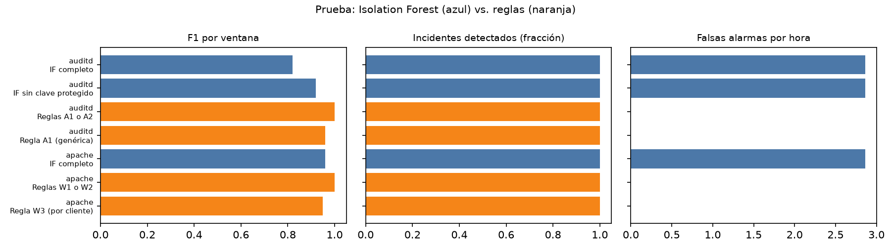
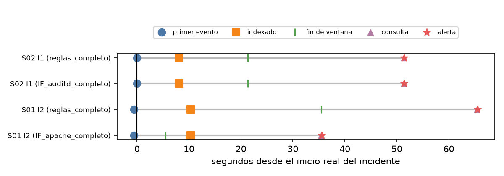
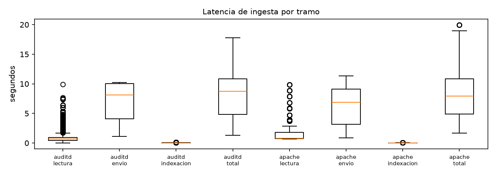
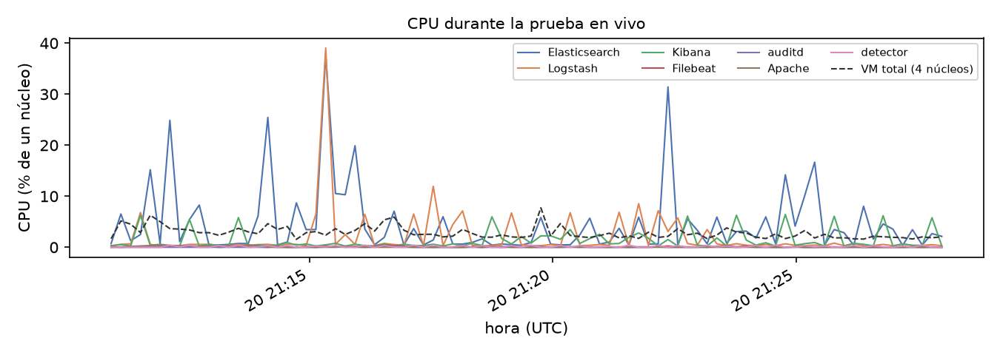

# Evaluación (T8) — generado por `src/evaluacion/evaluar.py` el 21/11/2026 01:21

Todo lo de este archivo se regenera con el script. Unidad por ventana: **30 s**. Resultados de **prueba** (sesiones nunca usadas para entrenar ni ajustar), salvo donde se indica.

**Asociación alerta–incidente:** una alerta detecta un incidente si cae en una ventana de su sesión con eventos del incidente o solapada con su intervalo; tolerancia adicional 0. **Deduplicación:** alertas de un mismo detector en ventanas consecutivas de una sesión = un episodio.

## 1. Comparación ML vs. reglas (prueba)

| fuente | detector | TP | FP | FN | TN | precisión | recall | F1 | incidentes | t. 1ª alerta mediana (s) | t. 1ª alerta máx. (s) | falsas alarmas/h | episodios | episodios falsos | episodios falsos/h |
|---|---|---|---|---|---|---|---|---|---|---|---|---|---|---|---|
| auditd | IF completo | 9 | 1 | 3 | 29 | 0.90 | 0.75 | 0.82 | 5/5 | 32.90 | 45.40 | 2.86 | 5 | 0 | 0.00 |
| auditd | IF sin clave protegido | 11 | 1 | 1 | 29 | 0.92 | 0.92 | 0.92 | 5/5 | 15.40 | 32.90 | 2.86 | 5 | 0 | 0.00 |
| auditd | Reglas A1 o A2 | 12 | 0 | 0 | 30 | 1.00 | 1.00 | 1.00 | 5/5 | 15.10 | 24.70 | 0.00 | 5 | 0 | 0.00 |
| auditd | Regla A1 (genérica) | 11 | 0 | 1 | 30 | 1.00 | 0.92 | 0.96 | 5/5 | 15.40 | 32.90 | 0.00 | 5 | 0 | 0.00 |
| apache | IF completo | 11 | 1 | 0 | 30 | 0.92 | 1.00 | 0.96 | 5/5 | 23.80 | 28.10 | 2.86 | 5 | 0 | 0.00 |
| apache | Reglas W1 o W2 | 11 | 0 | 0 | 31 | 1.00 | 1.00 | 1.00 | 5/5 | 23.80 | 28.10 | 0.00 | 5 | 0 | 0.00 |
| apache | Regla W3 (por cliente) | 10 | 0 | 1 | 31 | 1.00 | 0.91 | 0.95 | 5/5 | 23.80 | 28.10 | 0.00 | 5 | 0 | 0.00 |

Pares comparables: *IF completo* vs. *Reglas A1 o A2*; *IF sin clave protegido* vs. *Regla A1* (ninguno sabe cuál es el archivo vigilado); en Apache, *IF completo* vs. *Reglas W1 o W2*.

### 1.1 La misma comparación sin etiquetas

Umbral de cada regla = máximo de entrenamiento + 1 paso (A2 fijo en 1); Isolation Forest alerta si supera el puntaje máximo de entrenamiento. Ninguno usa las etiquetas de validación.

| fuente | detector | precision | recall | f1 | incidentes | falsas_alarmas_hora |
|---|---|---|---|---|---|---|
| auditd | reglas_completo | 1.0 | 1.0 | 1.0 | 5/5 | 0.0 |
| auditd | IF_auditd_completo | 0.5 | 0.0833 | 0.1429 | 1/5 | 2.86 |
| auditd | reglas_generico | 1.0 | 1.0 | 1.0 | 5/5 | 0.0 |
| auditd | IF_auditd_sin_clave_protegido | 1.0 | 0.5 | 0.6667 | 4/5 | 0.0 |
| apache | reglas_completo | 0.7857 | 1.0 | 0.88 | 5/5 | 8.57 |
| apache | IF_apache_completo | 0.8462 | 1.0 | 0.9167 | 5/5 | 5.71 |









## 2. Incidentes de prueba, uno por uno

Segundos desde el inicio real del incidente hasta el fin de la primera ventana alertada (evaluación offline: sin la latencia de ingesta, que se mide en la T7). **no** = no detectado.

### auditd (I1)

| sesión | intensidad (eventos/s) | duración (s) | eventos del incidente | IF completo | IF sin clave protegido | Reglas A1 o A2 | Regla A1 (genérica) |
|---|---|---|---|---|---|---|---|
| S11 | 1.96 | 46.3 | 102 | 24.7 | 24.7 | 24.7 | 24.7 |
| S14 | 1.24 | 54.3 | 72 | 32.9 | 32.9 | 2.9 | 32.9 |
| S16 | 2.88 | 59.2 | 170 | 11.1 | 11.1 | 11.1 | 11.1 |
| S26 | 2.15 | 44.4 | 97 | 45.1 | 15.1 | 15.1 | 15.1 |
| S35 | 1.88 | 42.2 | 80 | 45.4 | 15.4 | 15.4 | 15.4 |

### apache (I2)

| sesión | intensidad (eventos/s) | duración (s) | eventos del incidente | IF completo | Reglas W1 o W2 | Regla W3 (por cliente) |
|---|---|---|---|---|---|---|
| S04 | 4.35 | 38.1 | 164 | 23.8 | 23.8 | 23.8 |
| S06 | 6.59 | 36.4 | 250 | 27.5 | 27.5 | 27.5 |
| S07 | 7.76 | 45.2 | 343 | 28.1 | 28.1 | 28.1 |
| S22 | 4.38 | 41.8 | 196 | 23.6 | 23.6 | 23.6 |
| S32 | 1.16 | 57.1 | 79 | 14.7 | 14.7 | 14.7 |

## 3. Falsos positivos (prueba)

Ventanas sin incidente que alertaron. *Explicación* = las 3 características de la ventana más alejadas de la mediana de entrenamiento (columna `explicacion` de Isolation Forest).

| fuente | sesión | escenario | ventana | detectores | explicación (IF) | valores clave |
|---|---|---|---|---|---|---|
| apache | S32 | I2 | 1 | IF completo | web_peticiones=470 (z=+3.1); web_4xx=20 (z=+2.4); web_404=20 (z=+2.4) | peticiones=470, 4xx=20, clientes=3 |
| auditd | S35 | I1 | 1 | IF sin clave protegido | - | denegados=1, exec=142, eventos=603 |
| auditd | S35 | I1 | 4 | IF completo | aud_frac_denegados=0.0345 (z=+5.9); aud_exec=28 (z=-2.2); aud_pids_distintos=7 (z=-2.0) | denegados=1, exec=28, eventos=29 |

## 4. Resumen por escenario (prueba)

| escenario | sesiones | ventanas | con incidente | ambiguas | alertas IF completo | alertas reglas |
|---|---|---|---|---|---|---|
| B1 | 2 | 12 | 0 | 0 | 0 | 0 |
| I1 | 5 | 30 | 12 | 0 | 10 | 12 |
| B2 | 2 | 12 | 0 | 0 | 0 | 0 |
| I2 | 5 | 30 | 11 | 0 | 12 | 11 |

## 5. Isolation Forest: configuración elegida y estabilidad

| modelo | hiperparámetros | umbral | F1 prueba (10 semillas) | recall incidente (10 semillas) |
|---|---|---|---|---|
| apache_completo | transformacion=ninguna, n_estimators=100, max_samples=auto, max_features=1.0 | 0.6050 | 0.983 ± 0.028 | 1.00 ± 0.00 |
| auditd_completo | transformacion=log1p, n_estimators=300, max_samples=8, max_features=0.6 | 0.5540 | 0.806 ± 0.074 | 1.00 ± 0.00 |
| auditd_sin_clave_protegido | transformacion=log1p, n_estimators=100, max_samples=auto, max_features=1.0 | 0.5925 | 0.883 ± 0.048 | 1.00 ± 0.00 |

## 6. Prueba en vivo (T7)

Datos: `results/t7/vivo_20261120_181045`.

Segundos desde el inicio real del incidente (t = 0):

| sesión | detector | primer evento | indexado | fin de ventana | consulta | ALERTA | espera | procesamiento |
|---|---|---|---|---|---|---|---|---|
| S01 I2 | IF_apache_completo | -0.549 | 10.363 | 5.451 | 35.451 | 35.507 | 30.0 | 0.056 |
| S01 I2 | reglas_completo | -0.549 | 10.363 | 35.451 | 65.451 | 65.503 | 30.0 | 0.052 |
| S02 I1 | IF_auditd_completo | 0.001 | 8.064 | 21.352 | 51.352 | 51.411 | 30.0 | 0.059 |
| S02 I1 | reglas_completo | 0.001 | 8.064 | 21.352 | 51.352 | 51.411 | 30.0 | 0.059 |



Latencia de ingesta (todos los eventos de la prueba en vivo):

| fuente | tramo | n | mediana (s) | p95 (s) | máximo (s) |
|---|---|---|---|---|---|
| auditd | lectura | 2274 | 0.683 | 5.317 | 9.899 |
| auditd | envio | 2274 | 8.091 | 10.141 | 10.210 |
| auditd | indexacion | 2274 | 0.028 | 0.070 | 0.116 |
| auditd | total | 2274 | 8.708 | 15.390 | 17.772 |
| apache | lectura | 1688 | 0.819 | 5.839 | 9.853 |
| apache | envio | 1688 | 6.897 | 10.133 | 11.323 |
| apache | indexacion | 1688 | 0.013 | 0.045 | 0.088 |
| apache | total | 1688 | 7.927 | 13.999 | 19.976 |



CPU (% de un núcleo; `vm_total` = % de toda la VM de 4 núcleos) y memoria:

| componente | CPU media (%) | CPU máx. (%) | memoria media (MiB) | memoria máx. (MiB) |
|---|---|---|---|---|
| apache2 | 0.1 | 0.5 | 20 | 20 |
| auditd | 0.0 | 0.2 | 2 | 2 |
| detector | 0.1 | 0.4 | 162 | 163 |
| docker:lab-S01-atk | 0.2 | 0.3 | 14 | 14 |
| docker:lab-S01-c0 | 0.1 | 0.4 | 23 | 23 |
| docker:lab-S01-c1 | 0.3 | 1.3 | 18 | 18 |
| docker:lab-S03-c0 | 0.0 | 0.3 | 14 | 14 |
| docker:sor2-e3-es01-1 | 4.6 | 37.7 | 2996 | 3000 |
| docker:sor2-e3-kibana-1 | 1.4 | 6.4 | 1224 | 1225 |
| docker:sor2-e3-logstash-1 | 2.0 | 39.0 | 1008 | 1023 |
| filebeat | 0.1 | 0.4 | 137 | 140 |
| vm_mem_disponible | - | - | 2224 | 2276 |
| vm_total | 2.8 | 7.7 | - | - |



Completitud (eventos que llegaron después de la consulta del detector):

```
  auditd: 0/12 ventanas con eventos que llegaron después de la consulta; 0 de 2221 eventos (0.00 %)
  apache: 0/12 ventanas con eventos que llegaron después de la consulta; 0 de 1669 eventos (0.00 %)

```

## 7. Eventos perdidos y mal parseados

- auditd (`auditctl -s`, contador `lost` del núcleo antes y después de cada sesión): sin cambios en las 40 sesiones.
- Logs originales vs. Elasticsearch después del lote (`results/t8/recuentos_20261121_004838.txt`):

```
  auditd: 137249 líneas / 137249 docs / faltan 15 / de archivo rotado 0 / de más 0 / errores 15
  apache-access: 26350 líneas / 26350 docs / faltan 0 / de archivo rotado 0 / de más 0 / errores 0
  apache-error: 2 líneas / 83 docs / faltan 0 / de archivo rotado 81 / de más 0 / errores 0

Tipos de registro de auditd con ejemplo guardado: acquired-credentials, apache.access, authenticated, booted-system, bpf, changed-audit-configuration, changed-login-id-to, changed-promiscuous-mode-on-device, changed-to-runlevel, cwd, disposed-credentials, ended-session, execve, loaded-firewall-rule-to, logged-in, path, proctitle, ran-command, refreshed-credentials, rotated-audit-logs, shutdown-audit, shutdown-system, sockaddr, started-service, started-session, stopped-service, syscall, violated-apparmor-policy, was-authorized
```

